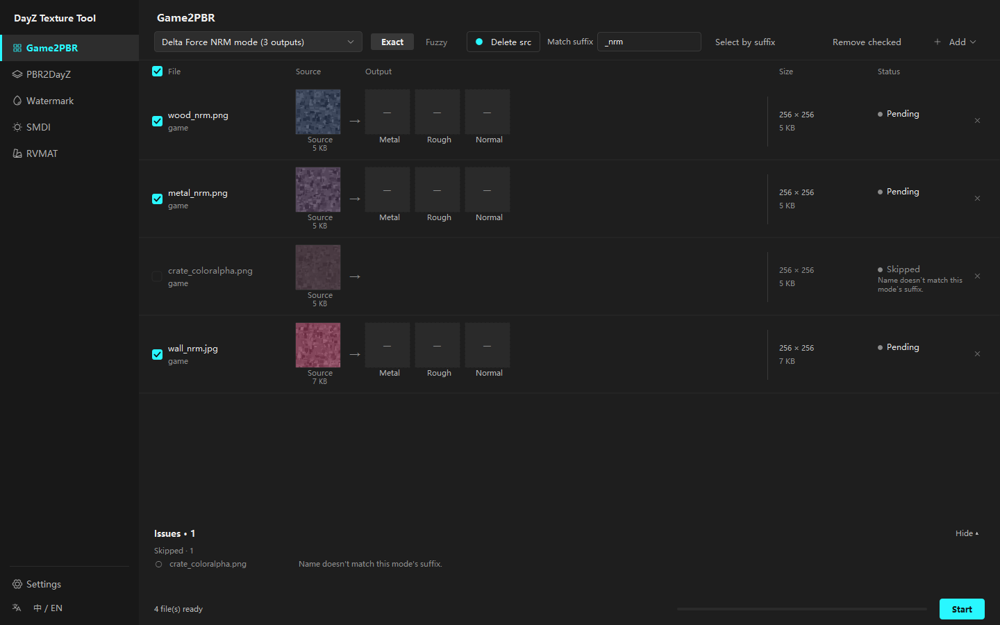
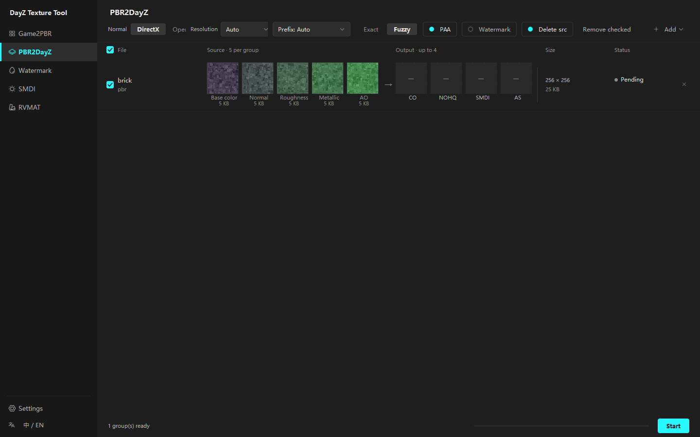
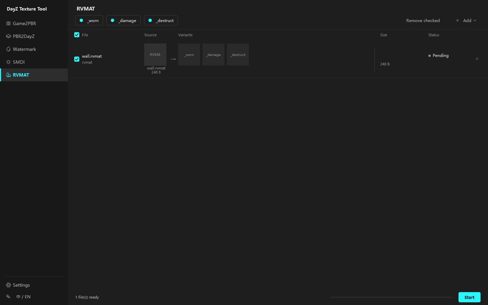
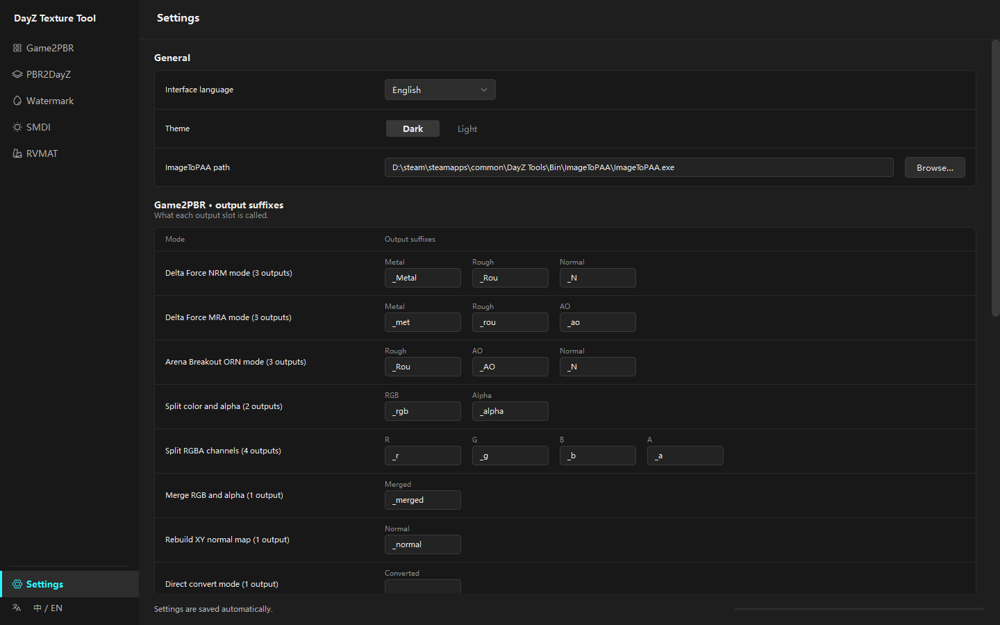

# DayZ Texture Tool

A Windows desktop tool for turning game texture dumps into DayZ-ready materials — channel splitting, PBR packing, blind watermarking, specular map generation and `.rvmat` damage variants, all in one window.

[](LICENSE)


**English** · [中文](README.zh-CN.md)



---

## What it does

Drop in files or a folder, pick a mode, press **Start**. Every source file becomes one row: the source thumbnail on the left, the outputs it will produce on the right, with file sizes and a per-file status. Files that will be skipped are greyed out and say why — so a wrong suffix setting shows up before you run anything, not after.

| Page | What it does |
| --- | --- |
| **Game2PBR** | Unpacks packed game textures (Delta Force, Arena Breakout, generic RGBA) into separate PBR maps |
| **PBR2DayZ** | Packs a standard PBR texture set into DayZ's `_co` / `_nohq` / `_smdi` / `_as` maps |
| **Watermark** | Embeds or extracts an invisible blind watermark |
| **SMDI** | Turns a colour map into a DayZ specular map using the in-game filter formula |
| **RVMAT** | Clones a `.rvmat` material into `_worn` / `_damage` / `_destruct` damage variants |
| **Settings** | Per-mode suffixes, keyword lists, tool paths, language, theme |

## The five processing pages

### Game2PBR

Nine modes, each declaring how many textures it produces:

| Mode | What it does | Outputs |
| --- | --- | --- |
| Delta Force NRM mode | Alpha → metallic, Blue → roughness, RG → normal | `_Metal` `_Rou` `_N` |
| Delta Force MRA mode | R → metallic, G → roughness, B → AO | `_met` `_rou` `_ao` |
| Arena Breakout ORN mode | G → roughness, R → AO, BA → normal | `_Rou` `_AO` `_N` |
| Split color and alpha | RGBA → colour (opaque) + greyscale alpha | `_rgb` `_alpha` |
| Split RGBA channels | RGBA → four independent greyscale maps | `_r` `_g` `_b` `_a` |
| Merge RGB and alpha | Colour + matching `_a` alpha map → RGBA | `_merged` |
| Rebuild XY normal map | Reconstructs Z from XY via `Nz = sqrt(1 - Nx² - Ny²)` | `_normal` |
| Direct convert mode | Copies pixels as-is, changes format/suffix only | *(custom)* |
| Direct invert mode | Inverts RGB (`1 - x`), with special handling of the blue channel | `_invert` |

Files are matched to a mode by filename suffix, either exactly or fuzzily.

### PBR2DayZ

Groups textures by folder and prefix, then packs each group into DayZ maps.

**Input types** (recognised by keyword, e.g. `roughness` / `rough` / `_r` / `_rou`): base colour, normal, roughness, metallic, AO. **Outputs**: `_co`, `_nohq`, `_smdi`, `_as`.

A group may hold anywhere from one to five source textures — only the outputs whose source exists are produced, and the missing slots stay visibly empty. Options: DirectX / OpenGL normal maps, resolution (auto / 256 / 512 / 1024 / 2048), five prefix rules, PAA output, and optional watermarking.



### Watermark

Invisible blind watermarking built on [`blind-watermark`](https://github.com/guofei9987/blind_watermark). Embed a text string into a texture, then recover it later with the password and the recorded watermark length. Works on PNG, JPG, BMP, TIF, TGA and PAA (PAA is decoded and re-encoded through `ImageToPAA.exe`). The watermark does not change how the image looks.

### SMDI

Converts a colour map (`_co` / `_ca`) into a DayZ specular map using the same formula as the in-game `specularMapFinish` filter:

```
R' = 1 - G
G' = G * ((sp * B + 1) / (sp + 1))
B' = B
A' = 255
```

`sp` is the specular power (default 10). Output goes next to the source as `<name>_smdi.tga`, or `.paa` with PAA output enabled.

### RVMAT

Copies a `.rvmat` material into `_worn` / `_damage` / `_destruct` variants, replacing only the `texture` line inside `class Stage3` with DayZ's generic damage textures. Everything else — indentation, spacing, line endings, encoding — is preserved byte for byte.

This is a port of the standalone `Rvmat-Creator` tool with four defects fixed: `texture = "..."` with spaces around the equals sign is now matched (about 9% of a real corpus uses that style), a file with no `class Stage3` reports a failure instead of silently producing a copy, CRLF line endings survive the edit, and GBK files no longer crash.



### Settings

Everything that rarely changes lives here instead of in the toolbars: per-mode match suffixes and output suffixes for all nine Game2PBR modes, PBR2DayZ keyword lists and output suffixes, the `ImageToPAA.exe` path, the interface language and the theme. Changes save automatically.



---

## Requirements

**To run the released build:** Windows 10 x64 or newer. Nothing else — Python is bundled.

**For PAA output:** `ImageToPAA.exe`, which ships with DayZ Tools on Steam (free). Point the tool at it under *Settings → General*:

```
...\steamapps\common\DayZ Tools\Bin\ImageToPAA\ImageToPAA.exe
```

Without it everything still works; PAA output is just skipped.

## Installation

1. Download `DayZ_Texture_Tool.zip` from the [latest release](../../releases/latest).
2. Extract it anywhere.
3. Run `DayZ_Texture_Tool.exe`.

No installer, no registry entries. To uninstall, delete the folder.

## Running from source

Requires Python 3.10 or newer (3.13 is what it is developed and tested against).

```bash
git clone https://github.com/MengYYY369/DayZ_Texture_Tool.git
cd DayZ_Texture_Tool
python -m venv .venv
.venv\Scripts\python -m pip install -r requirements.txt
.venv\Scripts\python -m pip install -e .
.venv\Scripts\python -m dayz_texture_tool
```

## Building a release

```powershell
powershell -ExecutionPolicy Bypass -File scripts\package.ps1
```

This creates a virtual environment, installs PyInstaller, runs the test suite, builds with PyInstaller and writes the result to `release\`. Flags: `-SkipTests`, `-NoClean`, `-NoZip`, `-Python <path>`.

## Supported formats

| | Formats |
| --- | --- |
| Game2PBR input | `.png` `.tga` `.tif` `.tiff` `.jpg` `.jpeg` `.bmp` `.dds` |
| PBR2DayZ input | `.png` `.jpg` `.jpeg` `.tga` `.bmp` `.tif` `.tiff` |
| Watermark / SMDI input | `.png` `.jpg` `.jpeg` `.bmp` `.tif` `.tiff` `.tga` `.paa` |
| RVMAT input | `.rvmat` |
| PAA output | via `ImageToPAA.exe` |

## Development

```bash
.venv\Scripts\python -m unittest discover -s tests
```

155 tests: 112 cover the processing logic, 43 cover the interface.

The processing layer (`processors/`, `batch.py`, `models.py`, `settings.py`) has no GUI dependency and can be imported and tested on its own. Interface tests run headless through Qt's `offscreen` platform plugin.

Source layout:

```
src/dayz_texture_tool/
  processors/     processing logic (game2pbr, pbr2dayz, smdi, watermark, rvmat)
  ui/
    pages/        one module per page
    widgets/      sidebar, toolbar, list view, row delegate, lightbox, issues panel
    translations/ dayz_zh_CN.ts / .qm
    theme.py      palette, font scale, global stylesheet
    shell.py      main window
docs/             feature report, design notes, screenshots
tests/            unittest suite
```

## Known limitations

- **Windows only.** The interface and the PAA step both assume Windows.
- **No way to stop a running batch.** It runs to completion.
- **One batch at a time.** Pages do not process in parallel.
- **PBR2DayZ grouping is folder-based.** With the default "auto" prefix rule, every texture in one folder becomes one group — give each texture set its own subfolder, or switch the prefix rule to "from filename".
- **PAA output requires dimensions divisible by 4**, and PAA is DXT1-compressed, so decoded G/B channels may differ from the TGA result by 1.
- **The release build is around 180 MB** unpacked. That is mostly Qt and OpenCV.

## License

[GPL-3.0](LICENSE). You are free to use, modify and redistribute this tool, provided derivative works are released under the same license.

## Acknowledgements

- [GameImageUtil](https://github.com/Scobalula/GameImageUtil) by Scobalula — the reference for the Game2PBR modes.
- [blind-watermark](https://github.com/guofei9987/blind_watermark) by guofei9987 — the watermarking engine.
- [Qt for Python (PySide6)](https://www.qt.io/qt-for-python) and [QtAwesome](https://github.com/spyder-ide/qtawesome) — the interface and its icons.
- [Pillow](https://python-pillow.org/), [NumPy](https://numpy.org/), [OpenCV](https://opencv.org/) and [PyWavelets](https://pywavelets.readthedocs.io/) — the image pipeline.
