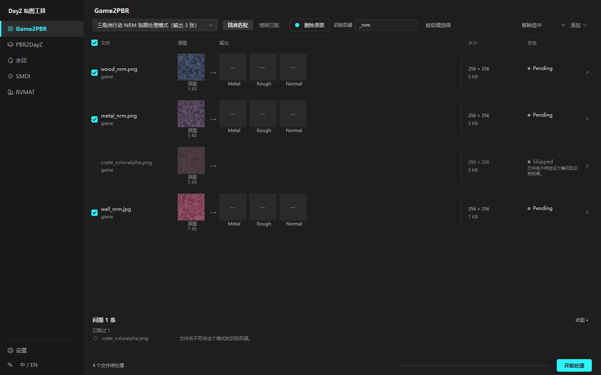
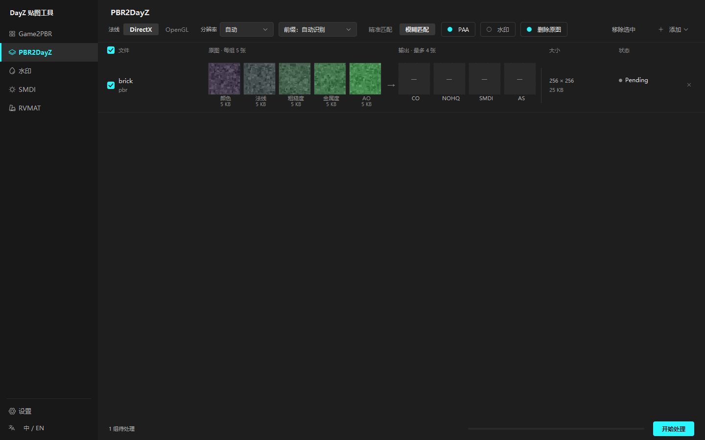

# DayZ 贴图工具

一个 Windows 桌面工具，把游戏里导出的贴图整理成 DayZ 能直接用的材质 —— 通道拆分、PBR 打包、盲水印、高光贴图生成、`.rvmat` 损坏变体，全在一个窗口里做完。

[](LICENSE)


[English](README.md) · **中文**



---

## 它是做什么的

把文件或整个文件夹拖进来，选好模式，点**开始处理**。每个源文件占一行：左边是原图缩略图，右边是这次会生成的几张图，附带文件大小和每行的状态。会被跳过的行整行变暗并写明原因 —— 所以后缀配错了，在按开始之前就能看见，而不是跑完才发现。

| 页面 | 做什么 |
| --- | --- |
| **Game2PBR** | 把游戏打包贴图（三角洲行动、暗区突围、通用 RGBA）拆成独立的 PBR 贴图 |
| **PBR2DayZ** | 把一套标准 PBR 贴图打包成 DayZ 的 `_co` / `_nohq` / `_smdi` / `_as` |
| **水印** | 嵌入或提取不可见盲水印 |
| **SMDI** | 按游戏内滤镜公式，把颜色贴图转成 DayZ 高光贴图 |
| **RVMAT** | 把一份 `.rvmat` 材质复制成 `_worn` / `_damage` / `_destruct` 三个损坏变体 |
| **设置** | 各模式的后缀、关键词表、工具路径、界面语言、主题 |

## 五个处理页面

### Game2PBR

九种处理模式，每个模式都会标明自己出几张图：

| 模式 | 做什么 | 输出 |
| --- | --- | --- |
| 三角洲行动 NRM 贴图处理模式 | 透明通道→金属度，蓝通道→粗糙度，RG→法线 | `_Metal` `_Rou` `_N` |
| 三角洲行动 MRA 贴图处理模式 | R→金属度，G→粗糙度，B→AO | `_met` `_rou` `_ao` |
| 暗区突围无限 ORN 贴图处理模式 | G→粗糙度，R→AO，BA→法线 | `_Rou` `_AO` `_N` |
| 颜色与透明通道拆分模式 | RGBA 拆成不透明彩色图 + 灰度透明图 | `_rgb` `_alpha` |
| RGBA 四通道拆分模式 | RGBA 各自拆成独立灰度图 | `_r` `_g` `_b` `_a` |
| RGB 与透明通道合并模式 | 彩色图 + 同名 `_a` 透明图合并成 RGBA | `_merged` |
| XY 法线贴图重建模式 | 按 `Nz = sqrt(1 - Nx² - Ny²)` 由 XY 重建完整法线 | `_normal` |
| 直接格式转换模式 | 原样复制像素，只改格式和后缀 | *（自定义）* |
| 直接反相处理模式 | RGB 反相（`1 - x`），蓝通道另有特殊处理 | `_invert` |

文件按文件名后缀匹配模式，可以精确匹配也可以模糊匹配。

### PBR2DayZ

按「文件夹 + 前缀」把贴图归组，每组打包成 DayZ 的贴图。

**输入类型**（按关键词识别，例如 `roughness` / `rough` / `_r` / `_rou`）：颜色、法线、粗糙度、金属度、AO。**输出**：`_co`、`_nohq`、`_smdi`、`_as`。

一组可以有 1 到 5 张源图 —— **只有存在的那几种类型才会生成对应输出**，缺的位置在界面上留空，一眼看得出。可调项：法线 DirectX / OpenGL、分辨率（自动 / 256 / 512 / 1024 / 2048）、五种前缀规则、生成 PAA、顺带加水印。



### 水印

基于 [`blind-watermark`](https://github.com/guofei9987/blind_watermark) 的不可见盲水印。把一段文字嵌进贴图，之后凭密码和水印长度提取还原。支持 PNG、JPG、BMP、TIF、TGA 和 PAA（PAA 会经 `ImageToPAA.exe` 解码后再编码回去）。嵌入前后图片肉眼完全一样。

### SMDI

把一张颜色贴图（`_co` / `_ca`）按游戏内 `specularMapFinish` 滤镜的同一条公式转成 DayZ 高光贴图：

```
R' = 1 - G
G' = G * ((sp * B + 1) / (sp + 1))
B' = B
A' = 255
```

`sp` 是高光强度，默认 10。输出写在源文件旁边，名为 `<名字>_smdi.tga`；勾选生成 PAA 时为 `.paa`。

### RVMAT

把一份 `.rvmat` 材质复制成 `_worn` / `_damage` / `_destruct` 三个变体，只替换 `class Stage3` 里的那一行 `texture`，换成 DayZ 自带的通用损坏贴图。其余部分 —— 缩进、空格、换行符、编码 —— 原样保留。

这是独立小工具 `Rvmat-Creator` 的移植版，顺手修掉了原版的四个缺陷：等号两边带空格的 `texture = "..."` 现在能认（真实语料里约 9% 是这种写法）、文件里没有 `class Stage3` 会明确报失败而不是静默生成一份副本、CRLF 文件不会混进 LF、GBK 文件不再直接报错。


### 设置

不常改的东西都放这儿，不占工具条：九种 Game2PBR 模式各自的识别后缀和生成贴图后缀、PBR2DayZ 的关键词表和输出后缀、`ImageToPAA.exe` 路径、界面语言、主题。改完自动保存。


---

## 运行要求

**用发布版：** Windows 10 64 位或更高。没别的了 —— Python 已经打包在里面。

**要用 PAA 输出：** 需要 `ImageToPAA.exe`，随 Steam 上的 DayZ Tools 一起提供（免费）。在*设置 → 通用*里指给它：

```
...\steamapps\common\DayZ Tools\Bin\ImageToPAA\ImageToPAA.exe
```

不配也能用，只是 PAA 输出会被跳过。

## 安装

1. 从[最新发布](../../releases/latest)下载 `DayZ_Texture_Tool.zip`。
2. 解压到任意位置。
3. 运行 `DayZ_Texture_Tool.exe`。

没有安装程序，不写注册表。想卸载，删掉文件夹就行。

## 从源码运行

需要 Python 3.10 或更高（开发和测试用的是 3.13）。

```bash
git clone https://github.com/MengYYY369/DayZ_Texture_Tool.git
cd DayZ_Texture_Tool
python -m venv .venv
.venv\Scripts\python -m pip install -r requirements.txt
.venv\Scripts\python -m pip install -e .
.venv\Scripts\python -m dayz_texture_tool
```

## 命令行用法

界面里那五套处理流程，不打开窗口也能跑。适合写成脚本批量处理，也适合让 AI 直接调用。

```bash
.venv\Scripts\python -m dayz_texture_tool.cli game --auto "C:\dump\rock"
```

安装之后还会多出一个 `dayz-texture-tool-cli` 命令，作用完全一样。单独跑 `dayz-texture-tool` 仍然是打开界面。

### 七个子命令

| 子命令 | 做什么 |
| --- | --- |
| `game` | Game2PBR：一张原贴图进去，一到四张出来。需要配 `--mode 名字` 或 `--auto`。 |
| `pbr` | PBR2DayZ：一组 PBR 贴图进去，最多四张出来。 |
| `watermark` | 加或查水印（`--mode embed` 加，`--mode detect` 查）。 |
| `smdi` | SMDI：一张颜色贴图进去，一张高光图出来。 |
| `rvmat` | RVMAT：一个材质进去，最多三个磨损变体出来。 |
| `settings` | `path` / `list` / `get 键` / `set 键 值`，键支持用点连起来。 |
| `gui` | 打开图形界面。 |

每个处理子命令后面可以跟一个或多个路径。**文件夹会一直往里翻**，子文件夹里的东西也会被处理。

### 几个例子

```bash
# Game2PBR，处理器由文件名后缀自己判断
dayz-texture-tool-cli game --auto "C:\dump\rock"

# Game2PBR，手动指定处理器，顺便改一个输出后缀
dayz-texture-tool-cli game --mode DF_NRM --out-suffix normal=_N "C:\dump\rock"

# PBR2DayZ，不生成 PAA，顺便加水印
dayz-texture-tool-cli pbr --no-paa --watermark --watermark-content "我的模组" "C:\dump\wall"

# SMDI，改一下高光强度
dayz-texture-tool-cli smdi --specular 12.5 "C:\dump\rock_co.tga"

# RVMAT，只要磨损版，并换成自己的磨损贴图
dayz-texture-tool-cli rvmat --variants worn --damage-texture worn=dz\characters\data\worn_mc.paa "C:\dump"

# 只看会发生什么，不真的写文件
dayz-texture-tool-cli --dry-run game --auto "C:\dump\rock"
```

### 全局开关

| 开关 | 作用 |
| --- | --- |
| `--json` | 输出一整块 JSON，给程序读，不给人读。 |
| `--dry-run` | 只试算，不写任何文件。 |
| `--settings 路径` | 用指定的那个 `settings.json`。 |
| `--quiet` | 不打印进度。 |
| `--verbose` | 配 `--json` 时也保留进度。 |
| `--strict` | 一件都没成功就报错退出。配 `--dry-run` 时无效。 |

这些开关放在子命令前面或后面都行。

### 输出和退出码

处理结果走**标准输出**，进度走**标准错误**，所以加了 `--json` 之后，输出永远是干净的、能被程序直接解析。JSON 只含 ASCII 字符，换什么代码页都不会乱码。

| 退出码 | 意思 |
| --- | --- |
| `0` | 该做的都做了。 |
| `1` | 至少有一个输入失败；或者加了 `--strict` 而一件都没成功。 |
| `2` | 用法错了：子命令不认识、模式名不认识、开关搭配不对、设置值不合法。 |

### 设置文件当默认值

每个开关的默认值都取自 `settings.json`，所以在界面里配好之后，命令行直接就能用，不用重复填。命令行上写的开关永远优先于文件。

```bash
dayz-texture-tool-cli settings path
dayz-texture-tool-cli settings get pbr_output_suffixes.co
dayz-texture-tool-cli settings set pbr_output_suffixes.co _custom
```

`settings set` 会先检查值和字段类型、允许的取值是否对得上；如果原来那个文件已经不是合法的 JSON，它宁可报错也不会写——绝不会把你的配置默默换成默认值。

### 和界面的三处不同

1. **文件夹一律往里翻。** 界面里只有 Game2PBR、PBR2DayZ、RVMAT 会这样。
2. **`--delete-source` 默认关闭。** 界面里是开着的。真想删掉原文件，得手动加上这个开关。
3. **手动指定 `--mode` 时不会按后缀筛文件。** 界面里会把跟当前处理器对不上的行藏起来。命令行上你点了名的文件都会处理；想让它自己判断该用哪个处理器，得用 `--auto`。

完整说明（每个开关、`--dry-run` 的状态词、JSON 结构）：[`docs/CLI.zh-CN.md`](docs/CLI.zh-CN.md)。

## 打包发布

```powershell
powershell -ExecutionPolicy Bypass -File scripts\package.ps1
```

脚本会建虚拟环境、装 PyInstaller、跑测试、打包，结果写到 `release\`。可选参数：`-SkipTests`、`-NoClean`、`-NoZip`、`-Python <路径>`。

## 支持的格式

| | 格式 |
| --- | --- |
| Game2PBR 输入 | `.png` `.tga` `.tif` `.tiff` `.jpg` `.jpeg` `.bmp` `.dds` |
| PBR2DayZ 输入 | `.png` `.jpg` `.jpeg` `.tga` `.bmp` `.tif` `.tiff` |
| 水印 / SMDI 输入 | `.png` `.jpg` `.jpeg` `.bmp` `.tif` `.tiff` `.tga` `.paa` |
| RVMAT 输入 | `.rvmat` |
| PAA 输出 | 经 `ImageToPAA.exe` |

## 开发

```bash
.venv\Scripts\python -m unittest discover -s tests
```

228 个用例：179 个覆盖处理逻辑与命令行，49 个覆盖界面。

处理层（`processors/`、`batch.py`、`models.py`、`settings.py`）不依赖界面，可以单独导入和测试。界面测试通过 Qt 的 `offscreen` 插件无头运行。

目录结构：

```
src/dayz_texture_tool/
  processors/     处理逻辑（game2pbr、pbr2dayz、smdi、watermark、rvmat）
  ui/
    pages/        一个页面一个文件
    widgets/      侧边栏、工具条、列表控件、行绘制、大图浮层、问题面板
    translations/ dayz_zh_CN.ts / .qm
    theme.py      调色板、字号台阶、全局样式表
    shell.py      主窗口
docs/             CLI 用法、功能报告、设计说明、截图
tests/            unittest 测试
```

## 已知限制

- **只支持 Windows。** 界面和 PAA 那一步都依赖 Windows。
- **没法中途停止。** 一批开始跑就得跑完。
- **一次只能跑一批。** 各页面不会并行处理。
- **PBR2DayZ 按文件夹分组。** 用默认的"自动"前缀规则时，同一个文件夹里所有贴图会被归成一组 —— 请给每套贴图一个单独的子文件夹，或者把前缀规则改成"从文件名取"。
- **PAA 输出要求宽高都是 4 的倍数**，而且 PAA 是 DXT1 有损压缩，解回来的 G/B 通道可能跟 TGA 结果差 1。
- **发布版解压后约 180 MB**，大头是 Qt 和 OpenCV。

## 开源协议

[GPL-3.0](LICENSE)。可以自由使用、修改和再分发，但改出来的东西必须用同样的协议开源。

## 致谢

- [GameImageUtil](https://github.com/Scobalula/GameImageUtil)（Scobalula）—— Game2PBR 各模式的参考。
- [blind-watermark](https://github.com/guofei9987/blind_watermark)（guofei9987）—— 水印引擎。
- [Qt for Python (PySide6)](https://www.qt.io/qt-for-python) 与 [QtAwesome](https://github.com/spyder-ide/qtawesome) —— 界面与图标。
- [Pillow](https://python-pillow.org/)、[NumPy](https://numpy.org/)、[OpenCV](https://opencv.org/)、[PyWavelets](https://pywavelets.readthedocs.io/) —— 图像处理流水线。
